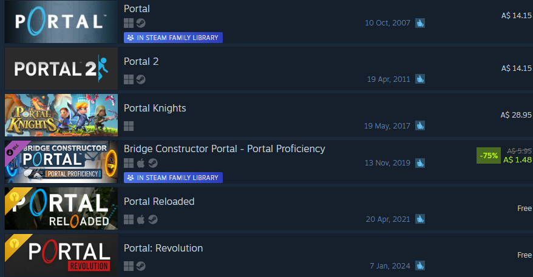
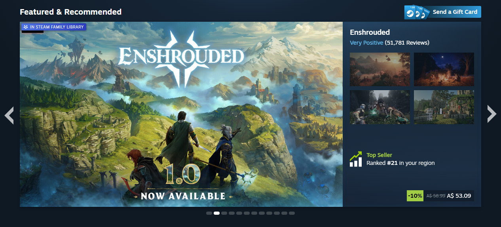
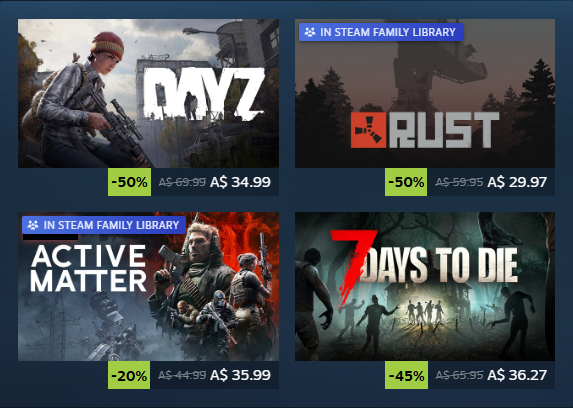
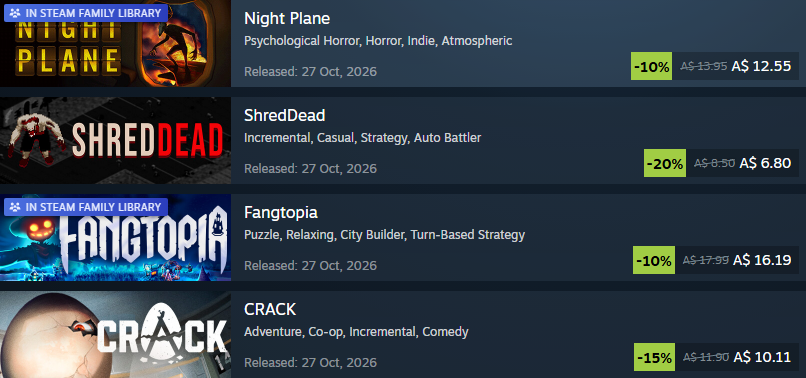

# Steam Family Share Badge

A Chrome and Firefox extension (also available as a userscript) that marks Steam store search results and game tiles (home page carousels, sales, lists) with an **In Steam Family Library** badge when the game is available to you through your Steam Family, so you don't have to open each listing to find out.

- Uses your existing Steam login in the browser; no API key or setup.
- Skips games you own yourself (Steam already shows those as "In Library").
- Caches the shared library for 6 hours. Click the extension icon (or use the userscript manager's menu) to refresh it sooner.

## Screenshots

**Search results**

**Home page featured carousel**

**Special offers and lists**

Screenshots use sample family library data.

## Install

### Chrome (and other Chromium browsers: Edge, Brave, Opera)

1. Download the zip for your OS (`-windows` or `-mac`) from [Releases](../../releases/latest) and unzip it.
2. Open `chrome://extensions` and turn on **Developer mode** (top right).
3. Click **Load unpacked** and pick the unzipped `steam-family-badge` folder.
4. Log in to the Steam store and search. Shared games get the badge.

### Firefox

1. Download the `-firefox` zip from [Releases](../../releases/latest), or build it yourself by running `build-firefox.ps1`, which writes it to `dist/`.
2. Open `about:debugging#/runtime/this-firefox` and click **Load Temporary Add-on...**.
3. Pick the `-firefox` zip (no need to unzip it).
4. Open `about:addons`, click **Steam Family Share Badge**, go to the **Permissions** tab, and turn on access for `store.steampowered.com` and `api.steampowered.com` if they're off.
5. Log in to the Steam store and search. Shared games get the badge.

Temporary add-ons are removed when Firefox restarts, so you'll need to load it again after a restart. For a permanent install, the zip has to be signed through [addons.mozilla.org](https://addons.mozilla.org/developers/).

### Userscript (Tampermonkey / Violentmonkey)

1. Install [Tampermonkey](https://www.tampermonkey.net/) or [Violentmonkey](https://violentmonkey.github.io/) in your browser.
2. Open [steam-family-badge.user.js](https://github.com/rushhee/steam-family-badge/releases/latest/download/steam-family-badge.user.js) and click **Install** when the userscript manager asks.
3. Log in to the Steam store and search. Shared games get the badge.

The userscript manager's menu has **Show family library status** and **Refresh family library**, in place of the extension popup. Updates are picked up automatically from the latest release. Greasemonkey isn't supported.

## Building

- Firefox zip: `build-firefox.ps1` writes `dist/steam-family-badge-v<version>-firefox.zip`.
- Userscript: `build-userscript.ps1` writes `dist/steam-family-badge.user.js` from the extension sources. The version comes from `manifest.json`, so bump it there for userscript managers to pick up an update.

## Notes

Shared games are read from Steam's `IFamilyGroupsService` web API, which is undocumented and may change. It works in Chrome, Firefox and as a userscript, not in the Steam client.
